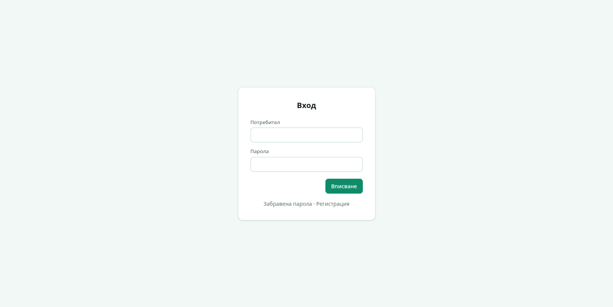
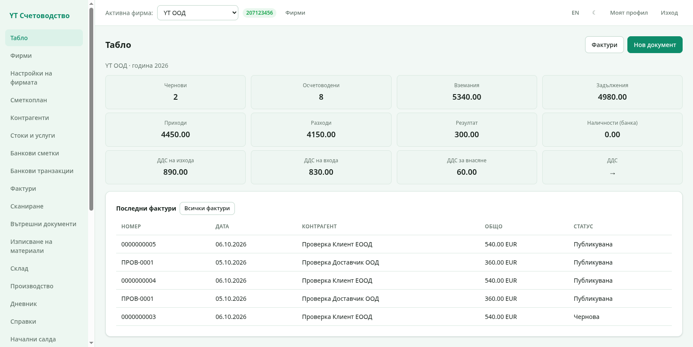
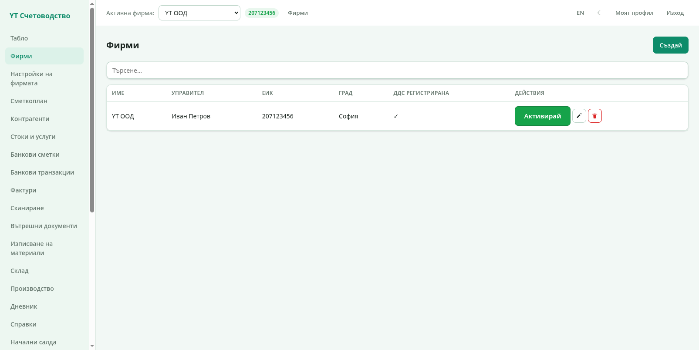

# 1. Запознаване

Тази глава покрива първите минути с програмата: вход, разположение на
екрана, таблото и работата с фирмите.

## Вход

Отворете адреса на програмата. Появява се екранът за вход:

1. Въведете **Потребител** (потребителско име или имейл).
2. Въведете **Парола**.
3. Натиснете **Вписване**.

Ако сте забравили паролата, ползвайте връзката **Забравена парола** —
писмо за възстановяване се изпраща на имейла на акаунта (работи при
зададени пощенски настройки от администратора). Връзката
**Регистрация** създава нов акаунт с нова фирма.

Няколко неща за сигурността:

- Паролите се пазят солени и хеширани (argon2id).
- Акаунтът може да има двуфакторна автентикация — включва се от
  „Моят профил" (вижте [Потребители и администриране](07-polzovateli.md)).
- След няколко неуспешни опита входът се забавя за кратко срещу
  автоматични атаки.

## Разположение на екрана

След влизане виждате основния екран:

- **Странично меню (вляво)** — всички секции на програмата: Табло, Фирми,
  Настройки на фирмата, Сметкоплан, Контрагенти, Стоки и услуги, Банкови
  сметки, Банкови транзакции, Фактури, Сканиране, Вътрешни документи,
  Изписване на материали, Склад, Производство, Дневник, Справки,
  Начални салда, Периоди, ДДС, Дивиденти, Валутни курсове, SAF-T,
  Кореспонденции, Номенклатури, ДМА, Глобални настройки, Моят профил,
  Потребители, Роли и права. Секциите зависят и от вашите права —
  без право за дадена секция тя не се показва.
- **Горна лента (горе)** — превключвател на **активната фирма** с нейния
  ЕИК, бутони за **език** (BG/EN), **тема** (светла/тъмна), връзка към
  профила ви и **Изход**.
- **Основна част (дясно)** — съдържанието на избраната секция.

### Смяна на език и тема

- Бутон **EN** / **BG** в горния десен ъгъл превключва езика на целия
  интерфейс. Изборът се запомня за следващите влизания.
- Бутонът с луната/слънцето превключва между светла (мента) и тъмна
  тема.

## Табло

Таблото е началната страница — бърз поглед към състоянието на активната
фирма:

Картите горе показват:

- **Чернови** — непубликувани документи;
- **Осчетоводени** — публикувани документи;
- **Вземания** — какво ви дължат клиентите;
- **Задължения** — какво дължите на доставчиците;
- **Приходи** и **Разходи** за периода;
- **Резултат** — приходи минус разходи;
- **ДДС** — начислен данък за периода.

Под картите е списъкът **Последни фактури** с най-новите документи —
кликнете ред, за да отворите документа.

## Фирми

Секция „Фирми" показва всички фирми, до които имате достъп:

- **Нова фирма** — създава фирма с име, ЕИК, ДДС номер, адрес и МОЛ.
- **Превключване** — изберете фирма от падащото меню „Активна фирма" в
  горната лента. Всички екрани следват активната фирма.
- **Редакция и изтриване** — действията вдясно на всеки ред.

> Демо инсталацията идва с фирма **YT ООД** (ЕИК 207123456) с примерни
> фактури и счетоводни записи — удобно за преглед, преди да въведете
> реалните си данни.

### Първи стъпки с нова фирма

1. Създайте фирмата от „Фирми".
2. Отворете **Настройки на фирмата** и попълнете данните — вижте
   [Фирма и сметкоплан](02-firma-i-smetkoplan.md).
3. Заредете сметкоплана с бутона за seed от НАП.
4. Добавете контрагенти и стоки, след което издайте първата фактура —
   [Фактури](03-fakturi.md).

## Навигация с клавиатура и навици

- **Enter** изпраща повечето форми; **Esc** затваря диалоговите
  прозорци.
- След създаване на запис програмата ви връща към списъка или към
  създадения документ.
- Дати се попълват като `13.10.2026` или чрез календера до полето.

Следваща глава: [Фирма и сметкоплан](02-firma-i-smetkoplan.md).
