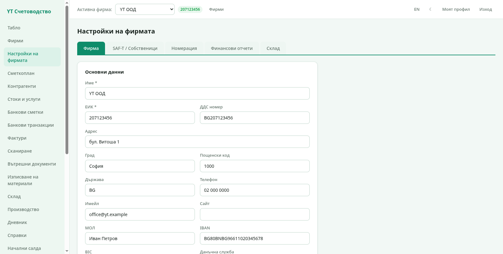
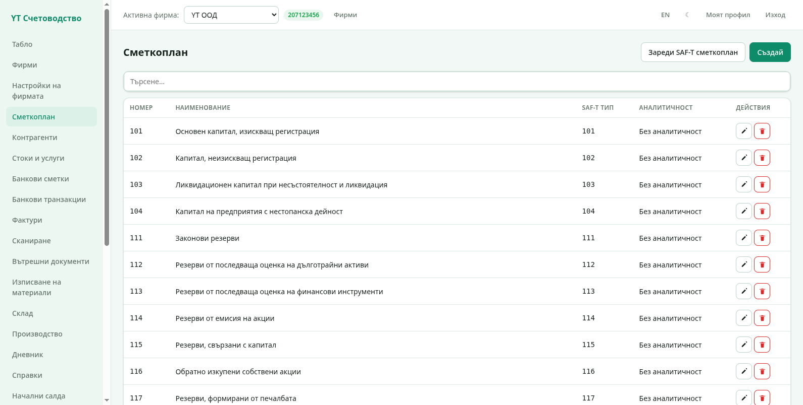

# 2. Фирма и сметкоплан

Настройките на фирмата определят как изглеждат документите ѝ, къде отиват
счетоводните записи и как се номерират документите. Всичко се намира в
**Настройки на фирмата** в страничното меню.

## Табове на настройките

Страницата има пет таба:

1. **Фирма** — основни данни, управител, счетоводител, ДДС настройки;
2. **SAF-T / Собственици** — обекти, действителни собственици, крайни
   майки (данни, които НАП иска в SAF-T файла);
3. **Номерация** — серии документи и следващите номера;
4. **Финансови отчети** — настройки за отчетите;
5. **Склад** — правила за складовото счетоводство (сметки и методи).

### Таб „Фирма"

- **Основни данни** — име, ЕИК, ДДС номер, адрес, град, пощенски код,
  държава, телефон, имейл, сайт, МОЛ, IBAN и BIC, данъчна служба и офис
  на НАП. Тези данни се отпечатват върху фактурите като доставчик.
- **Управител и счетоводител** — имена и ЕГН на управителя,
  счетоводителя и пълномощника (за протоколи и декларации).
- **ДДС и фискален период** — дали фирмата е ДДС регистрирана, ДДС
  периодът (месечен или тримесечен), валутата на счетоводството,
  поделение (клон) и началният месец на фискалната година.
- **Интеграции** — API ключове за изкуствен интелект при сканиране на
  фактури (по фирма).

Промените се записват с бутона **Запази данните** долу.

### Таб „SAF-T / Собственици"

- **Обекти** — седалище, складове и клонове на фирмата. Обектът се
  избира при всеки документ и определя в кой склад влиза/излиза
  стоката.
- **Действителни собственици** и **крайни майки** — физически лица и
  чуждестепенни майки; излизат в SAF-T файла.

### Таб „Номерация"

Всяка серия документи има име, префикс и следващ номер. Програмата
предлага автоматичен номер при нов изходящ документ (полето „Номер" в
новата фактура). Можете да въведете и свой номер — тогава автоматичното
номериране продължава от по-голямото от двете.

### Таб „Склад"

Правилата казват по коя сметка се отразява покупката, продажбата и
изписването на стоки. Ако правилото липсва, складовите справки дават
предупреждение вместо запис.

## Сметкоплан

Секция **Сметкоплан** показва сметките на активната фирма:

- **Seed от НАП** — зарежда стандартния национален сметкоплан. Може да
  се използва повторно: съществуващите номера не се дублират.
- **Нова сметка** — създава сметка с номер, име, тип и помо­щна
  информация. Пълният номер се образува от номер + няколко нива —
  синтетични и аналитични сметки по българската практика.
- **Редакция** — променя името и атрибутите на сметката.

Сметките с начало на номера от съответния клас (4xx клиенти, 5xx
доставчици, 7xx приходи, 6xx разходи) се ползват автоматично от
документите — вижте главите за фактури и склад.

Следваща глава: [Фактури](03-fakturi.md).
