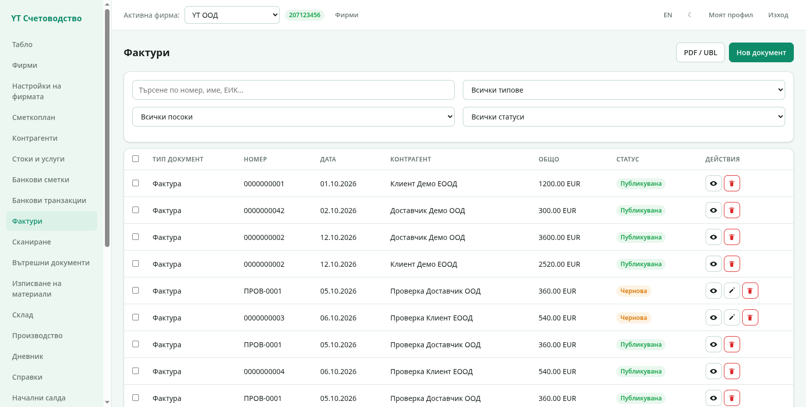
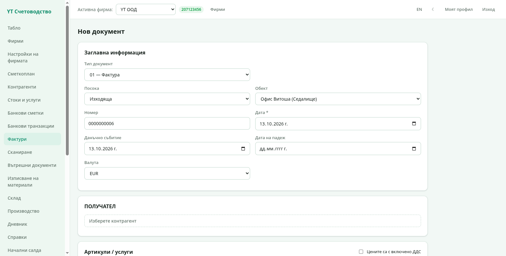
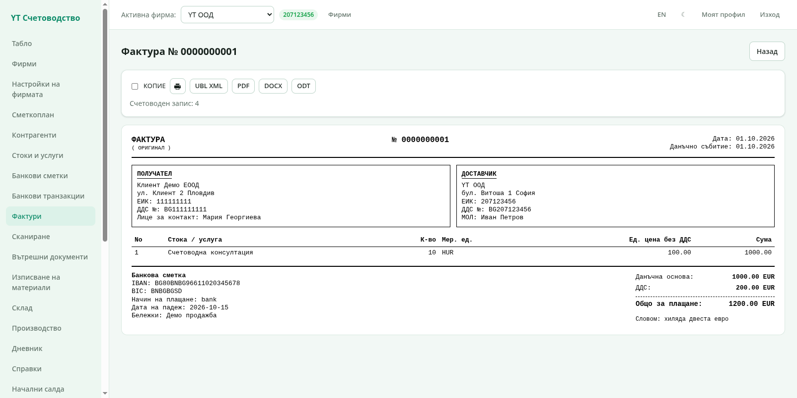
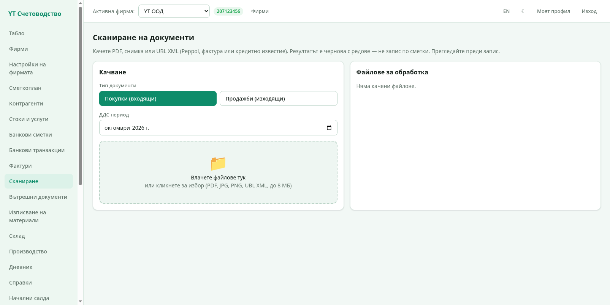

# 3. Фактури

Фактури са сърцето на програмата. Една фактура минава през три състояния:
**чернова** → **публикувана** → при нужда **сторно**. Публикуването прави
счетоводния запис в дневника.

## Списъкът с фактури

- **Търсене** — по номер, име на контрагент или ЕИК.
- **Филтри** — по тип документ и по статус (чернова / публикувана).
- **Нов документ** — отваря формата за нова фактура (по-долу).
- **Действия вдясно** — преглед (икона с око), редакция (молив — само за
  чернови) и изтриване.

Статусът е цветен: зелено **Публикувана** и оранжево **Чернова**.

## Създаване на нов документ

От „Фактури" → **Нов документ**:

### Заглавна информация

- **Тип документ** — 01 Фактура (стандартната), 02 Дебитно известно,
  03 Кредитно известно, Проформа (не е данъчен документ), протоколи и
  специалните типове по ЗДДС. Типът определя как се отразява данъкът.
- **Посока** — *Изходяща* (продажба, ваша фактура) или *Входяща*
  (покупка, фактура на доставчик).
- **Обект** — седалището или складът, към който е документът. При
  входящи фактури обектът определя **в кой склад влиза стоката**; при
  изходящи — от кой склад излиза.
- **Номер** — за изходящи документи програмата предлага следващия
  свободен номер автоматично; можете да го смените.
- **Дата** и **Данъчно събитие** — датата на документа и датата на
  данъчното събитие (обикновено съвпадат).
- **Дата на падеж** — когато плащането е със срок.
- **Валута** — EUR, BGN, USD и други; счетоводният запис е в евро по
  курса на ЕЦБ за датата.

### Получател

Натиснете **Изберете контрагент** и изберете от списъка, или създайте
нов директно от диалога. Ако контрагентът е с български ЕИК и ДДС номер,
програмата проверява номера в **VIES** и попълва адреса автоматично.

### Артикули / услуги

Всеки ред има:

- **Стока / услуга** — избира се от „Стоки и услуги" или се описва
  свободно (свободното описание се запомня за следващия път);
- **К-во** и **Мерна единица** — бр., кг, м, ч и още над сто единици от
  номенклатурата на НАП;
- **Ед. цена без ДДС** и **ДДС %** — 20%, 9% или 0%;
- полето „**Цените са с включено ДДС**" превръща въведените цени в
  такива с данък и обратно.

Редове се добавят с **+ Добави ред** и се махат с ✕.

### Плащане и тотали

- **Начин на плащане** — банков превод, в брой, карта, компенсация,
  друго;
- **Отстъпка %** — намалява данъчната основа;
- **Бележки** — свободен текст, отпечатва се върху документа.

Долу се пресмятат живо: сума без отстъпка, отстъпка, данъчна основа,
ДДС и **Общо за плащане**.

Запазете с **Запази** — документът остава чернова и може да се
редактира.

## Преглед и публикуване

Отворете документа от списъка:

Вижда се пълната фактура: получател и доставчик, редовете, тоталите
(подравнени вдясно), сумата **словом**, банковата сметка за плащане и
бележките. Ако документът е публикуван, горе пише номерът на
**счетоводния запис** (връзка към дневника).

- **Публикуване** — прави счетоводния запис и сменя статуса на
  „Публикувана". От този момент документът не се редактира. Не може да
  се публикува документ в **затворен период**.
- **КОПИЕ** — поставя надпис „копие" при печат.
- **Печат** (иконата с принтера) — отваря системния печат с бланката;
  същият като PDF експорта.
- **PDF / DOCX / ODT** — изтеглят документа във формат по избор; PDF е с
  вграден шрифт и се отваря еднакво навсякъде.
- **UBL XML** — електронният формат на фактурата (EN 16931) за обмен с
  партньори, които го изискват.

### Черно сторно

Грешна публикация се коригира със **сторно**: програмата създава
огледален документ със същите редове и **отрицателни суми** — дебитът и
кредитът не се разменят. Сторното се публикува като обикновен документ
и нулира ефекта на оригинала, след което издавате правилния документ.

## Сканиране на фактура

Секция **Сканиране** превръща качена снимка или PDF на получена фактура
в чернова:

1. Качете файла (PDF, JPG, PNG).
2. Изкуственият интелект разчита контрагента, датата, номерата,
   редовете и сумите.
3. Проверете разчетеното и запазете — документът се появява като
   чернова входяща фактура.

> Сканирането изисква API ключ за Mistral AI, настроен в „Настройки на
> фирмата" → „Интеграции". Ключът е по фирма; данните се обработват от
> европейски оператор.

## UBL вход

Като алтернатива на сканирането може да качите директно **UBL XML
файл** — програмата го разбира и създава чернова с данните от него,
без разпознаване по картинка.

Следваща глава: [Стоки и склад](04-sklad.md).
