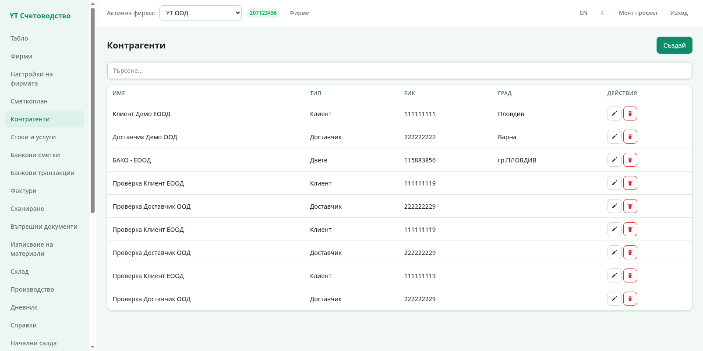
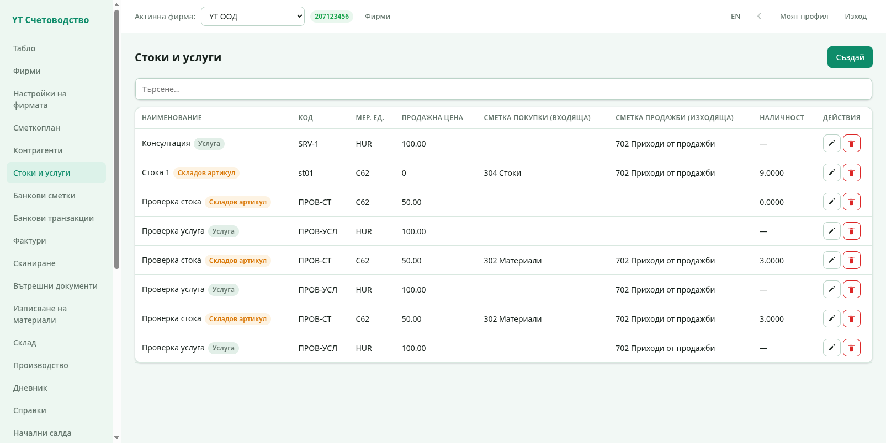
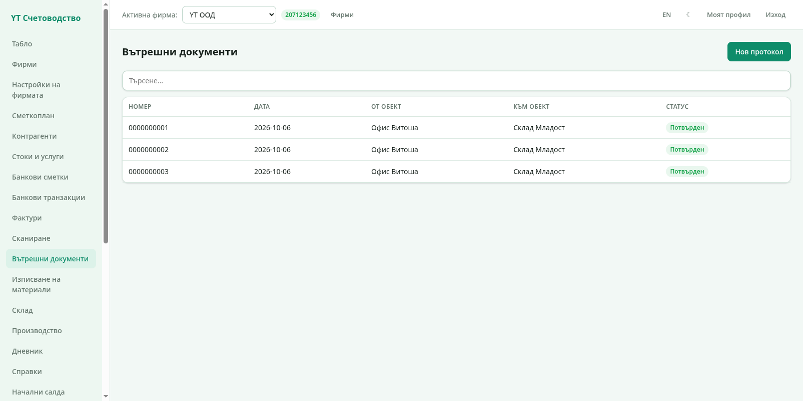
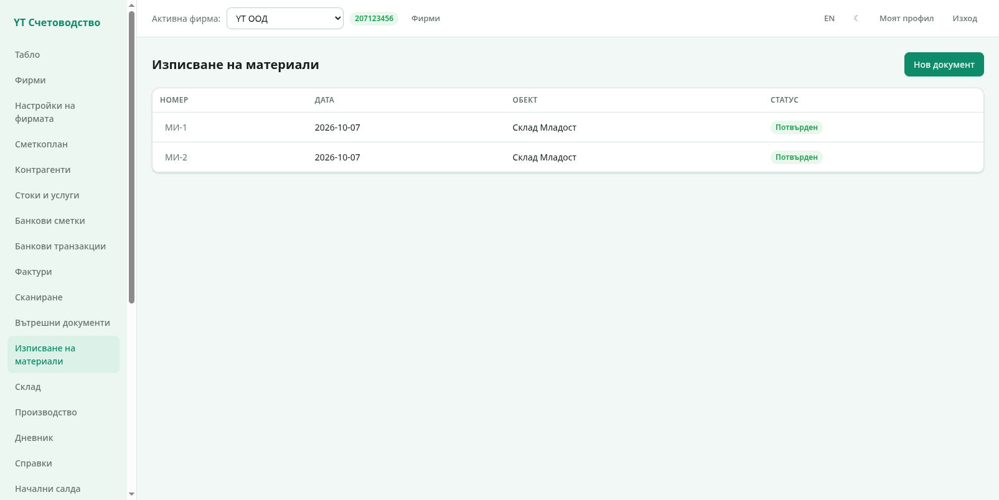
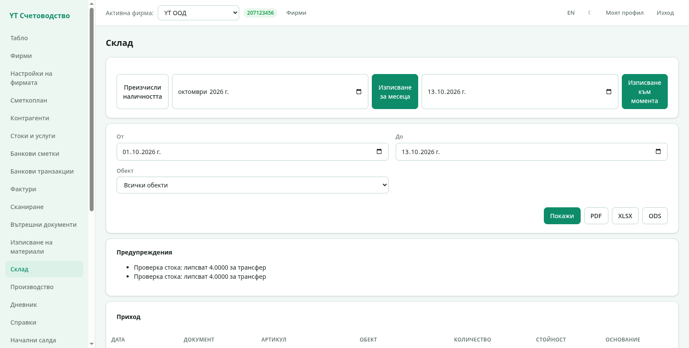
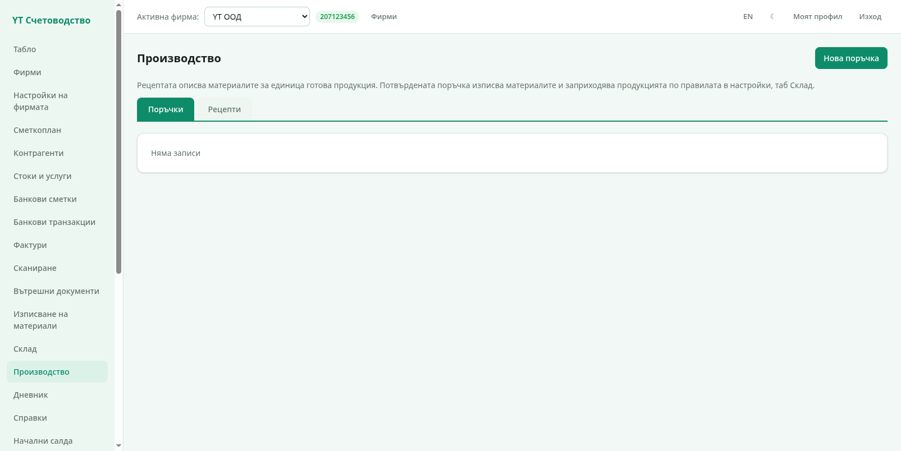

# 4. Стоки и склад

Складовият модул следи количествата по обекти: стоката влиза с входящите
фактури, излиза с изходящите, а вътрешните документи я местят между
обектите.

## Контрагенти

Секция **Контрагенти** пази клиентите и доставчиците — име, ЕИК, ДДС
номер, адрес и контакти. При български ДДС номер програмата проверява
регистрацията в **VIES** и разчленява адреса на улица, номер, град и
пощенски код.

Контрагентите се избират в документите; нов може да се създава и
директно от самата фактура.

## Стоки и услуги

Секция **Стоки и услуги** е номенклатурата на артикулите:

Всеки артикул има:

- **Наименование** и тип — услуга или складов артикул;
- **Код** — ваш собствен код (напр. `SRV-1`, `st01`);
- **Мерна единица** — от каталога на НАП;
- **Продажна цена** — предлага се автоматично в новите изходящи
  фактури;
- **Сметка покупка** и **Сметка продажба** — по кои сметки отива
  стоката в счетоводството (напр. 304 Стоки и 702 Приходи от продажби);
- **Наличност** — текущото количество (пресмята се от склада, вижте
  по-долу).

Бутонът **Създай** добавя нов артикул; моливът и кофата редактират и
трият.

## Как се движи стоката

1. **Входяща фактура** с обект „Склад Младост" → стоката влиза в този
   обект.
2. **Вътрешен документ** (трансфер) → мести стоката между два обекта.
3. **Изходяща фактура** → стоката излиза от обекта на документа.
4. **Изписване на материали / производство** → материалите се
   изписват за нуждите на фирмата или се превръщат в продукция.

## Вътрешни документи

Секция **Вътрешни документи** описва придвижването между обектите:

Новият документ избира **от обект** и **към обект**, добавя редове с
артикули и количества, и се потвърждава. След потвърждаване количеството
намалява в първия обект и расте във втория; документът има печатна
бланка като фактурите.

## Изписване на материали

Секция **Изписване на материали** е за ръчно изписване — брак,
производствени нужди, служебна употреба. Документът избира обект и
артикули с количества; при потвърждение количествата намаляват, а
стойността отива по правилата от „Настройки на фирмата" → таб „Склад".

## Склад

Секция **Склад** е централната складова справка:

Горният панел управлява изчислението:

- **Преизчисли наличността** — пресмята всички количества отначало по
  документите;
- **Изписване за месеца** (избира се месец) — месечно изписване на
  продадените стоки;
- **Изписване към момента** (избира се дата) — изписване на всичко
  продадено до датата.

Долу е самата справка с филтри **От**, **До** и **Обект**. Бутонът
**Покажи** я рисува на екрана, а **PDF / XLSX / ODS** я изтеглят като
файл. Таблиците показват прихода и разхода на стоки по обекти с
количествата, стойностите и основанията (кой документ е мръднал
стоката).

> Карта „Предупреждения" събира проблемите — например липсващо правило
> за сметка или отрицателна наличност при трансфер. Отстранете
> причината и пресметнете отново.

## Производство

Секция **Производство** превръща материали в готова продукция:

Има два таба:

- **Рецепти** — описват материалите за **единица** готова продукция
  (рецептурна карта);
- **Поръчки** — производствени поръчки. Потвърдената поръчка изписва
  материалите по рецептата и заприходява готовата продукция — по
  сметките от „Настройки на фирмата" → таб „Склад".

Бутонът **Нова поръчка** създава поръчка за избран продукт и
количество; производственият протокол се отпечатва като документ.

Следваща глава: [Счетоводство](05-schetovodstvo.md).
