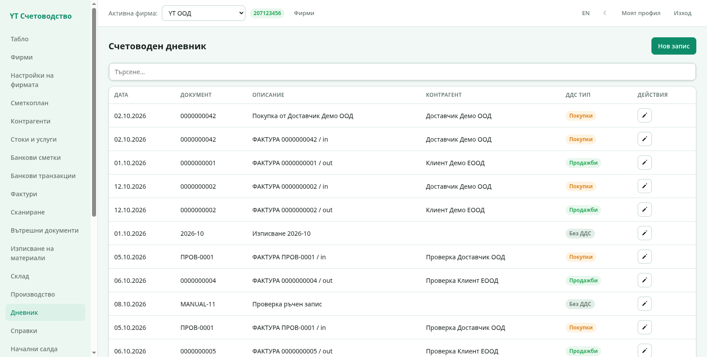
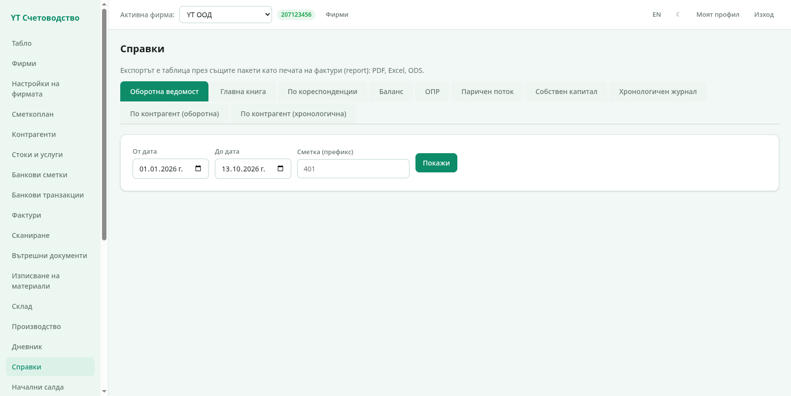
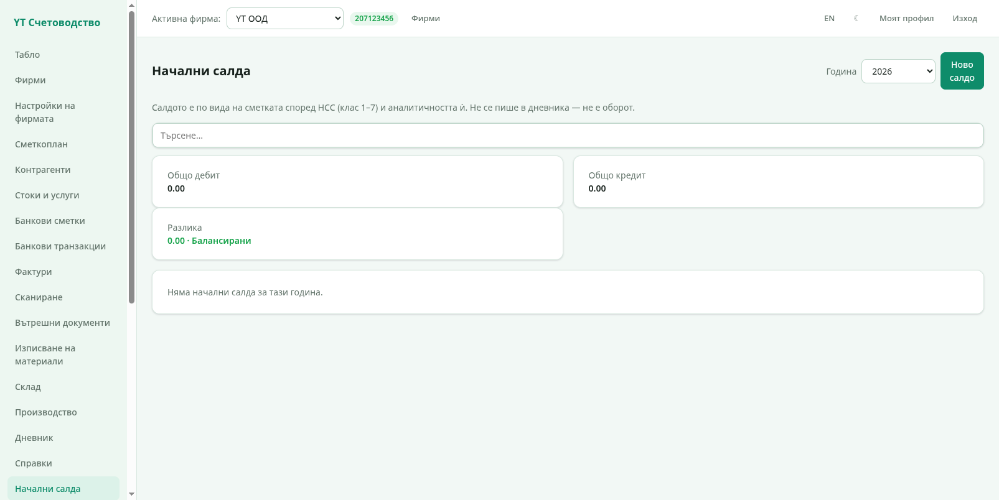
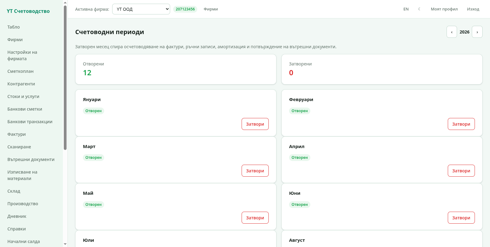
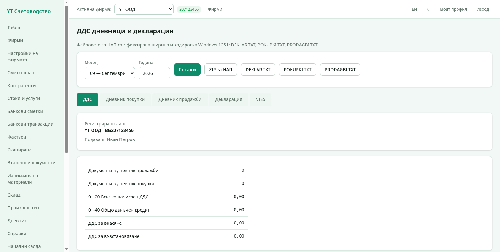
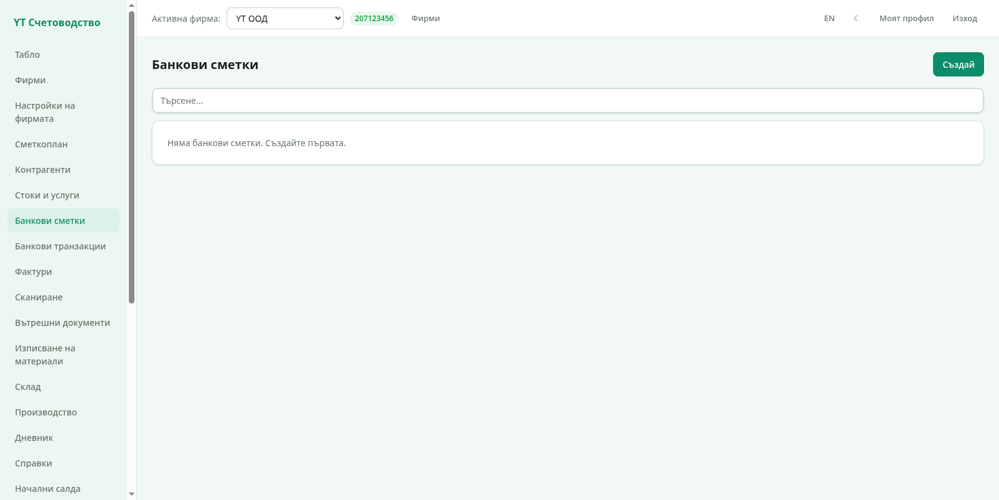
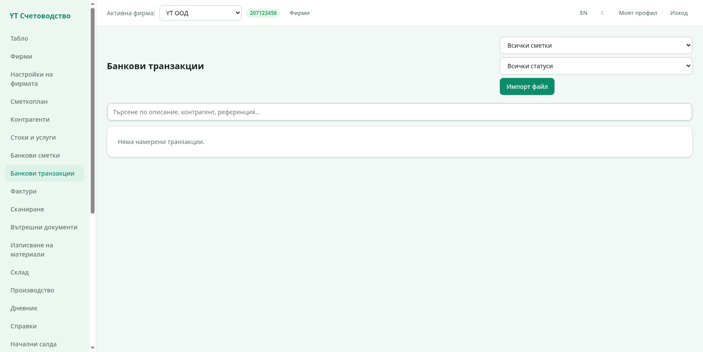
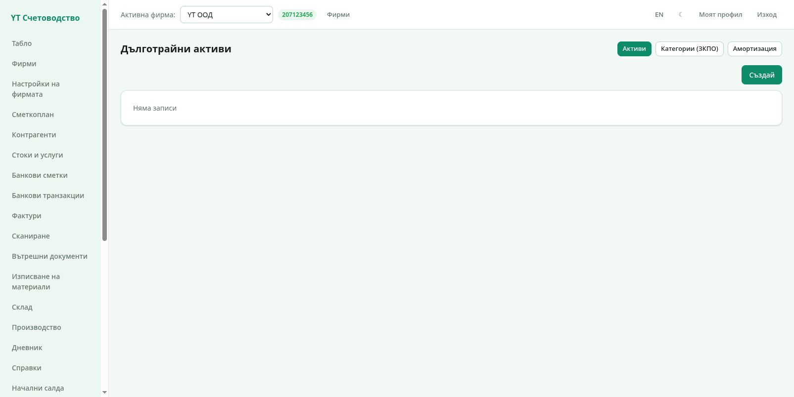
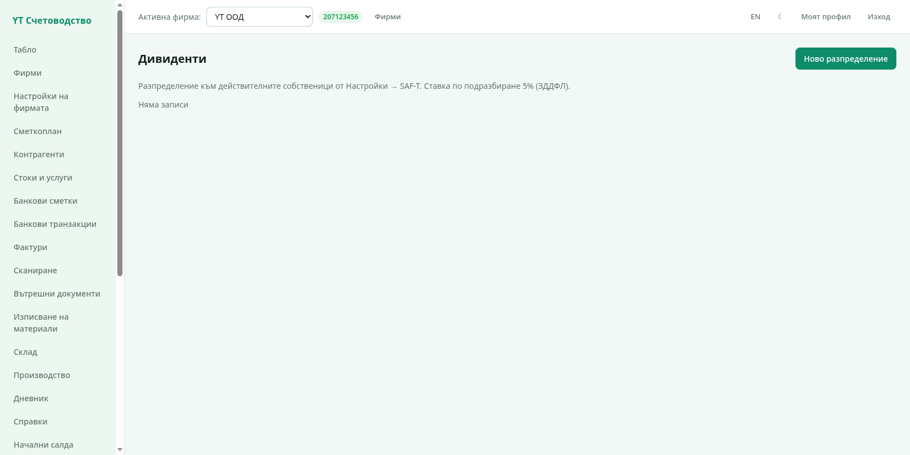
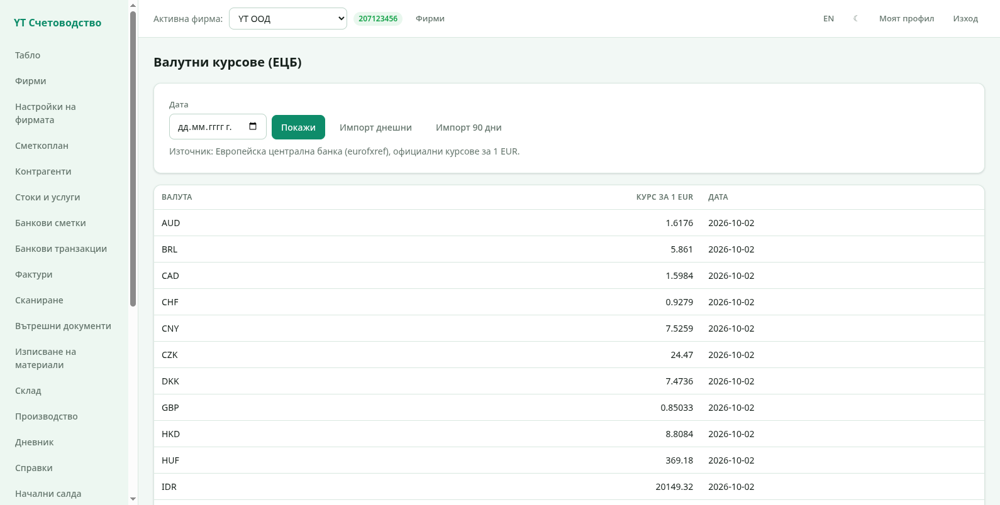

# 5. Счетоводство

Тази глава обхваща дневника, справките, периодите, ДДС декларацията,
банките и останалите счетоводни модули.

## Счетоводен дневник

Дневникът пази всички счетоводни записи. Запис идва автоматично при
публикуване на фактура, изписване от склада или производствена поръчка,
а може да се въведе и **ръчно** с бутона **Нов запис**.

Колоните показват датата, номера на документа, описанието,
контрагента и дали записът е с ДДС тип покупки (оранжево), продажби
(зелено) или без ДДС (сиво). Модалът за нов/редактиран запис съдържа
датата, описанието и редовете със сметка, дебит или кредит и сума —
сумата на дебита трябва да е равна на кредита.

> Записите, направени от документи, се трият и пресъздават при промяна
> на документа. Ръчните записи имат собствено описание и се редактират
> от дневника. Те имат и отметки за избор — **Избери всички ръчни
> записи** маркира всички, а **Изтрий** ги изтрива групово след
> потвърждение. Груповото триене не засяга записи от документи.

## Справки

Секция **Справки** предлага стандартните счетоводни отчети:

Отчети с табове горе:

- **Оборотна ведомост** — оборот и салдо по сметки;
- **Главна книга** — движения по избран(и) сметка(и);
- **По кореспонденции** — двойки дебитна/кредитна сметка;
- **Баланс**, **ОПР** (отчет за приходите и разходите), **Паричен
  поток**, **Собствен капитал** — отчетите, които се пълнят от
  формулите на фирмата (настроени в „Настройки на фирмата" → таб
  „Финансови отчети");
- **Хронологичен журнал** — записите в реда на възникването;
- **По контрагент (оборотна и хронологична)** — разбивка по клиент или
  доставчик.

Филтрите са **От дата**, **До дата** и **Сметка (префикс)** — префиксът
`401` взема всички аналитични към сметката. **Покажи** рисува справката
на екрана; PDF, XLSX и ODS изтеглят таблицата като файл.

> В експорта има отметка **„Български формат на числата (1 200,00)"**.
> Когато е включена, числата се форматират с интервал за хилядите и
> запетая за десетичните, както ги очаква български LibreOffice.
> Изключена, файловете са в международен формат с точка.

## Начални салда

Секция **Начални салда** въвежда салдата в началото на фискалната
година — по сметка, с дебит или кредит. Тези суми участват в справките,
но не пишат в дневника. За да се въведат, **януари трябва да е отворен
период** (вижте по-долу).

## Периоди

Секция **Периоди** управлява дванадесетте месеца на годината:

- **Приключвателни операции** — в края на месеца от страницата «Счетоводни
  периоди» бутонът «Приключи» показва преглед и записва балансирана статия
  (`CLOSE-YYYY-MM`), която приключва салдата по зададената в настройките карта
  (таб «Приключване»: напр. група 60 → 611, а 602 → 612). Повторно приключване
  за същия месец не е позволено, докато статията не се изтрие от дневника.
- **Затваряне на месец** — след приключване на месеца той се затваря:
  публикуване на документи с дата в него вече не е възможно.
- **Отваряне** — връща месеца за промяна, ако трябва да се коригира
  нещо.
- Липсващ ред се смята за отворен период.

Затварянето на месеца е вашата защита: приключената отчетност не може
да се промени случайно.

## ДДС дневници и декларация

Секция **ДДС** съставя данъчните дневници и файловете за НАП:

1. Изберете **Месец** и **Година** и натиснете **Покажи**.
2. Табовете показват **Дневник покупки**, **Дневник продажби**,
   **Декларация** и **VIES** проверка на контрагентите.
3. Обобщението показва документите в двата дневника, начисления ДДС,
   данъчния кредит и **ДДС за внасяне или възстановяване**.
4. Бутоните изтеглят файловете за НАП — **DEKLAR.TXT** (декларацията),
   **POKUPKI.TXT** и **PRODAGBI.TXT** (двата дневника) или всичко в
   **ZIP за НАП**. Файловете са с кодировка Windows-1251, готови за
   портала на НАП.

Данните се събират от публикуваните фактури за съответния ДДС период
(месечен или тримесечен, както е настроен фирмата).

## Банкови сметки и транзакции

Секция **Банкови сметки** пази IBAN и BIC на сметките на фирмата:

Секция **Банкови транзакции** приема извлечения:

- Импорт на **CSV**, **MT940** и **XML** (Postbank, UniCredit, OBB и
  стандартен ISO **camt.053**) — програмата разпознава формата
  автоматично;
- Всяка транзакция може да се **осчетоводи** — избира се сметка и
  контрагент и записът отива в дневника; **разнасянето** съпоставя
  транзакциите с фактури и ги затваря взаимно.

## ДМА (дълготрайни активи)

Секция **ДМА** води дълготрайните активи: **категории** с гаранционен
срок и **активи** с начална стойност. Програмата пресмята и записва
**месечната амортизация** (Дт 603 / Кт 241) с един бутон. Поддържат се
преоценка, местене между обекти, консервация и отписване.

## Дивиденти

Секция **Дивиденти** изчислява дивиденти към действителните
собственици (от настройките на фирмата): размер на дивидента, удържан
данък и протокол за изплащане.

## Валутни курсове

Секция **Валутни курсове** държи курсовете на ЕЦБ — за 1 EUR срещу
всяка валута. Бутонът за импорт дръпва **дневния** или **историческия**
набор директно от ЕЦБ; липсващ ден ползва най-близкия по-ранен курс.

Курсовете се ползват автоматично при фактури и плащания във валута.

Следваща глава: [SAF-T](06-saft.md).
