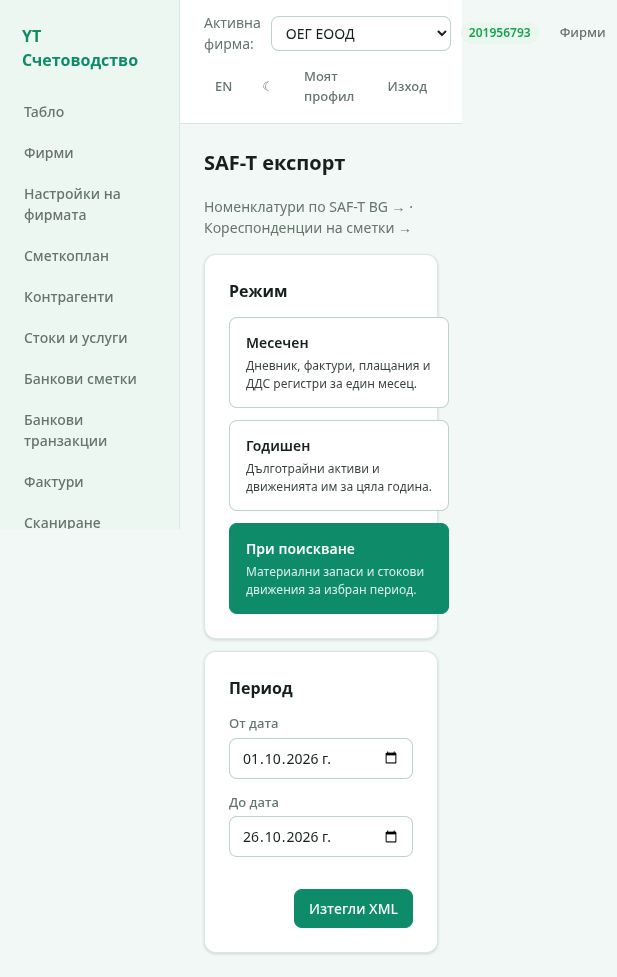
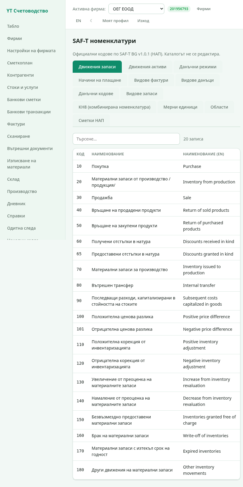

# 6. SAF-T

SAF-T (Standard Audit File for Taxation) е файловият формат за
данен одит на НАП. ytbuch генерира SAF-T XML по схемата V1.0.1 и пази
номенклатурите и съпоставянията, които файлът изисква.

## Експорт на SAF-T

Секция **SAF-T** изготвя файла:

1. Изберете **режим** — месечен, годишен или при поискване. Всеки режим
   има кратко описание какво включва;
2. Задайте **периода** според режима:
   - **Месечен** — месец: дневник, фактури, плащания и ДДС регистри;
   - **Годишен** — година: дълготрайни активи и движенията им;
   - **При поискване** — дати **От** и **До**: материалните запаси и
     стоковите движения са само в този период. Началната наличност е
     към деня преди „От", крайната — към „До";
3. Изтеглете XML файла.

Файлът съдържа регистрираното лице, обектите, собствениците,
контрагентите, стоките, дневника с редовете и двата ДДС дневника за
периода — всичко, което НАП изисква от одитния файл.

> Пълна валидация срещу XSD схемата минава, когато периодът е
> „затворен" от данни: месец с банкови плащания, година с активи и
> склад с наличности. Работете с данните на фирмата и файлът ще е
> готов за подаване.

## Номенклатури

Секция **Номенклатури** показва дванадесетте статични каталога на
НАП:

- сметки (сметкопланът на НАП — около 360 сметки);
- **КН8** — Комбинираната номенклатура с кодове и наименования за
  стоките, с търсене по код или текст. Тя стои зад класификацията на
  артикулите (глава 4) и техния код в SAF-T файла;
- мерни единици (127);
- данъчни кодове (169);
- типове документи, държави, градове, валути, начини на плащане и
  други.

Каталогът е готов — той се ползва от всички документи (типове фактури,
мерни единици, данъчни кодове) и не се редактира.

## Кореспонденции

Секция **Кореспонденции** („Съпоставяне на SAF-T движения") казва на
експорта как да се опишат определени движения: **стокови**
(покупка/продажба/извод), **активи** и **парични**. Всеки ред съпоставя
вид движение със стандартни дебитна и кредитна сметка. Програмата
предлага стандартните двойки; можете да ги коригирате според практиката
на фирмата.

Следваща глава: [Потребители и администриране](07-polzovateli.md).
