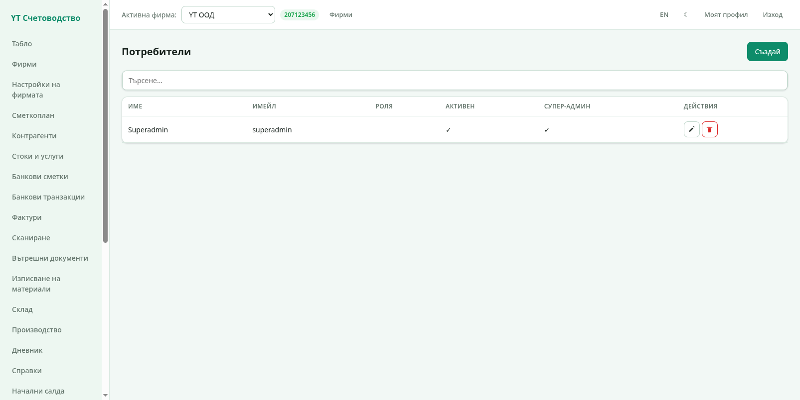
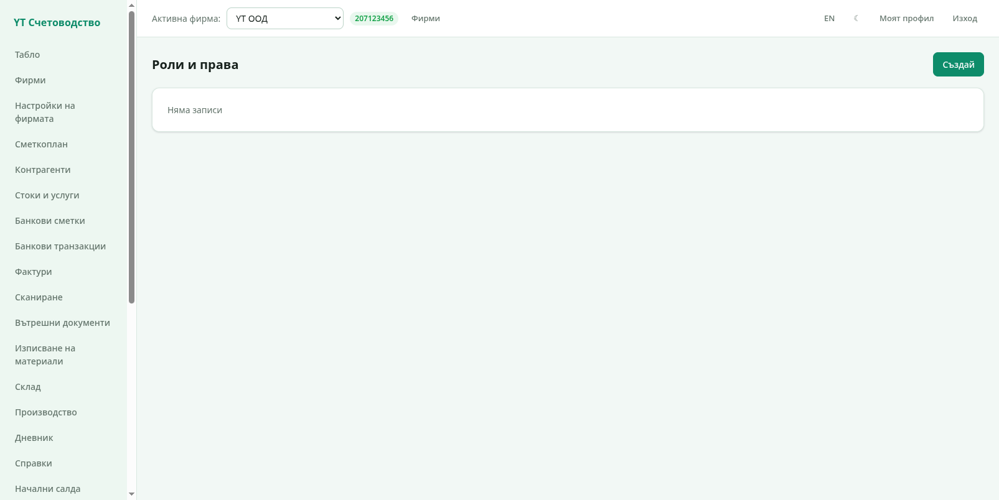
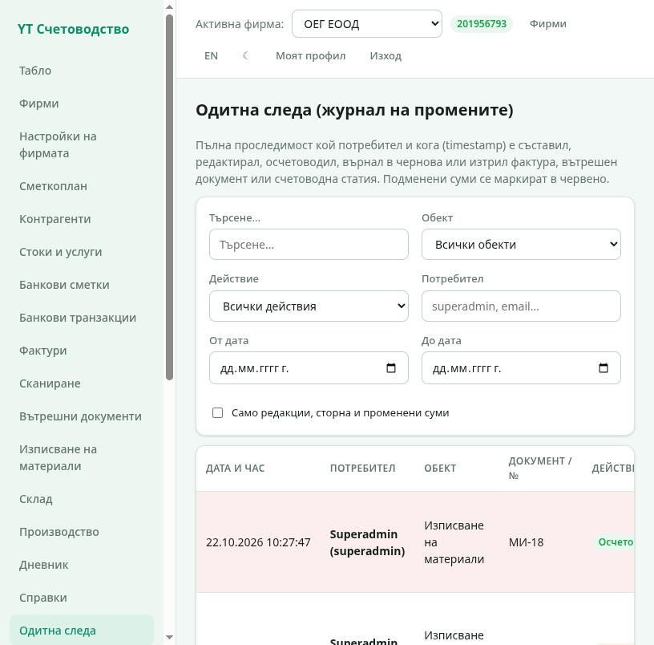
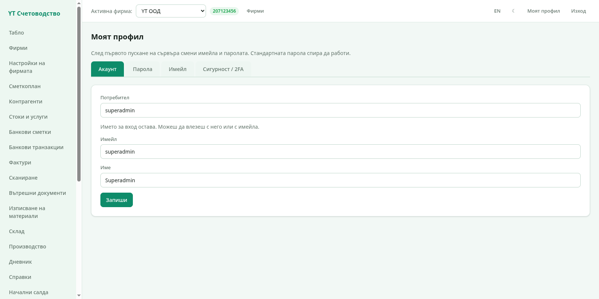
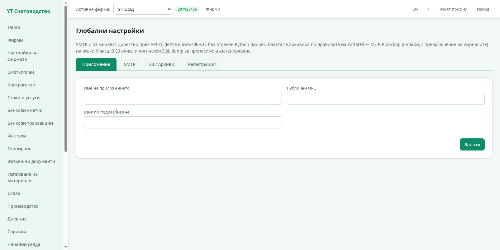

# 7. Потребители и администриране

Тази глава е за администраторите: потребители, роли и права, профил,
двуфакторна автентикация, глобални настройки и архивиране.

## Потребители

Секция **Потребители** показва всички акаунти:

- **Нов потребител** — име за вход, имейл, парола (поне 8 знака) и
  роля;
- **Редакция** — смяна на ролята, имейла и данните;
- **Изтриване** — с две защити: собственият ви акаунт и последният
  супер администратор не могат да се трият.

Всеки потребител влиза със своето име и вижда само фирмите, до които
име права.

## Роли и права

Секция **Роли и права** дефинира какво може всяка роля:

Правата са по секции на програмата — например *фактури*, *склад*,
*дневник*, *ДДС*, *потребители*, *настройки*. Роля с всички права има
`*`. Проверката е в самия сървър: потребител без право за секция
получава отказ, а мъртвите екрани не се показват в менюто му. Така
можете спокойно да дадете на счетоводителя само счетоводни права, а на
оператора — само фактури.

Супер администраторът минава без проверки и вижда всичко.

## Одитна следа

Секция **Одитна следа** е журналът на промените: кой потребител и кога е
съставил, редактирал, осчетоводил, върнал в чернова или изтрил фактура,
вътрешен протокол, изписване на материали, производствена поръчка,
дивидент или счетоводна статия.

Филтрите по **обект** и **действие** стесняват списъка, а отметката
**„Само редакции, сторна и променени суми"** скрива рутинните записи.
Променените суми се маркират в червено. Всеки ред води към документа, а
историята на обекта показва съдържанието му преди и след промяната.

## Моят профил

Секция **Моят профил** е личният екран на всеки потребител:

- **Име** — показваното име;
- **Парола** — смяна на паролата;
- **Имейл** — смяна на имейла (изисква паролата, защото хешът на
  паролата включва имейла);
- **2FA (двуфакторна автентикация)** — включва се като сканирате QR
  кода с приложение като Google Authenticator или Aegis. При влизане
  се иска шестцифрен код от приложението. Резервните кодове се
  изтеглят като файл — пазете ги, те са единственият резервен вход
  при загубен телефон.

## Глобални настройки (админ)

Секция **Глобални настройки** е само за супер администратори:

- **Поща (SMTP)** — сървър, порт, потребител и парола. Бутонът за тест
  изпраща пробно писмо, за да проверите настройките. Пощата се ползва
  за забравена парола и регистрационни писма;
- **Архив в облак (S3)** — адрес, ключ и кофа. Бутоните тестват
  връзката, показват наличните архиви и качват нов;
- **Регистрация** — включва/изключва публичната регистрация на нови
  фирми;
- **Адрес на програмата (app.url)** — адресът, който се ползва в
  писмата с връзки.

## Архивиране

Архивирането работи на две нива:

1. **Автоматично локално** — базата YottaDB се архивира по собствената
   ѝ система (MUPIP BACKUP) на всеки 6 часа. Пазят се последните 8
   архива; по-старите се изтриват сами.
2. **В облак (S3)** — от „Глобални настройки" бутонът за бекъп
   качва най-новия локален архив и SQL дъмп на данните в конфигурираната
   S3 кофа. Списъкът в администраторския екран показва качените
   архиви, от където могат и да се изтрият.

За пълна защита дръжте поне един архив извън машината — S3 кофата или
изтеглен файл.

---

Това е краят на потребителската документация. Върнете се към
[съдържанието](README.md).
